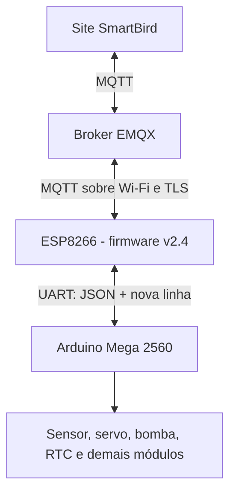
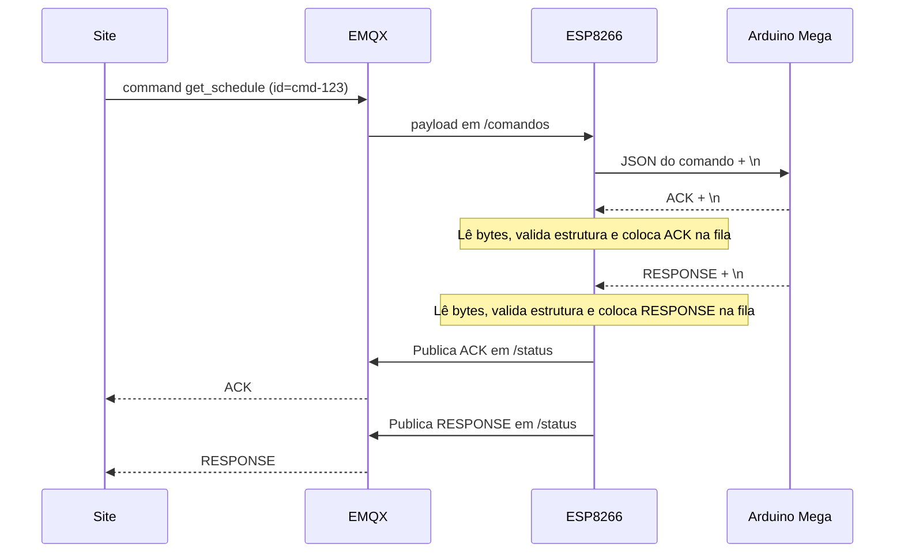

# Guia completo do firmware SmartBird ESP8266 v2.4

> **Material de estudo — C++ para Arduino, comunicação UART, MQTT e filas de mensagens**  
> Projeto: **SmartBird**  
> Firmware estudado: **ESP8266 v2.4 — ponte transparente MQTT/UART com fila de JSONs**

Este guia explica o funcionamento do firmware v2.4 do ESP8266, desde a arquitetura geral até a sintaxe utilizada em cada função. O objetivo é compreender **o que cada trecho faz, por que ele existe e como as partes trabalham juntas**, especialmente a solução que impediu que mensagens ACK e RESPONSE fossem truncadas ou misturadas.

O texto foi preparado em **Markdown compatível com GitHub**, incluindo diagramas Mermaid, tabelas, trechos de C++ e exercícios. Ele complementa o arquivo `.ino` do firmware; as credenciais de acesso devem permanecer fora da documentação pública.

## Índice

1. [Visão geral do sistema](#1-visão-geral-do-sistema)
2. [O problema original e a solução](#2-o-problema-original-e-a-solução)
3. [Conceitos de C++ necessários](#3-conceitos-de-c-necessários)
4. [Bibliotecas e configurações](#4-bibliotecas-e-configurações)
5. [Objetos de comunicação e portas seriais](#5-objetos-de-comunicação-e-portas-seriais)
6. [Buffers, estruturas e fila circular](#6-buffers-estruturas-e-fila-circular)
7. [Intervalos de tempo e controle de execução](#7-intervalos-de-tempo-e-controle-de-execução)
8. [Função `jsonIntegro()`](#8-função-jsonintegro)
9. [Função `adicionarNaFila()`](#9-função-adicionarnafila)
10. [Função `lerDadosDoMega()`](#10-função-lerdadosdomega)
11. [Função `uartLivre()`](#11-função-uartlivre)
12. [Função `mostrarJSONRecebido()`](#12-função-mostrarjsonrecebido)
13. [Função `publicarFila()`](#13-função-publicarfila)
14. [Função `callback()`](#14-função-callback)
15. [Wi-Fi: `setup_wifi()` e `gerenciarWiFi()`](#15-wi-fi-setup_wifi-e-gerenciarwifi)
16. [MQTT: `reconnect()`](#16-mqtt-reconnect)
17. [Função `mostrarAvisos()`](#17-função-mostraravisos)
18. [Inicialização: `setup()`](#18-inicialização-setup)
19. [Execução contínua: `loop()`](#19-execução-contínua-loop)
20. [Simulação completa de ACK e RESPONSE](#20-simulação-completa-de-ack-e-response)
21. [Diferenças entre os firmwares v2.2 e v2.4](#21-diferenças-entre-os-firmwares-v22-e-v24)
22. [Limitações, riscos e melhorias futuras](#22-limitações-riscos-e-melhorias-futuras)
23. [Como estudar e depurar o firmware](#23-como-estudar-e-depurar-o-firmware)
24. [Exercícios com gabarito](#24-exercícios-com-gabarito)
25. [Resumo final](#25-resumo-final)

---

## 1. Visão geral do sistema

### 1.1. O papel do ESP8266 no SmartBird

O ESP8266 funciona como uma **ponte de comunicação**. Ele não decide quanto alimento liberar, não controla diretamente a bomba e não interpreta regras de agendamento. Essas decisões pertencem ao **Arduino Mega**, que é o controlador principal.

Uma analogia útil:

- **Site:** o gerente que solicita tarefas e consulta resultados.
- **EMQX:** o serviço que distribui mensagens entre os participantes.
- **ESP8266:** o mensageiro que transporta comandos e respostas.
- **Arduino Mega:** quem interpreta os comandos e executa as operações físicas.

### 1.2. Arquitetura



O fluxo tem duas direções:

**Site → Arduino:** o site publica no tópico `smartbird/gaiola01/comandos`; o ESP recebe o payload MQTT e o transmite pela UART para o Mega.

**Arduino → Site:** o Mega envia ACKs, RESPONSEs, eventos, erros e telemetrias; o ESP os lê pela UART, os coloca numa fila e publica no tópico `smartbird/gaiola01/status`.

### 1.3. ACK não é RESPONSE

O protocolo diferencia duas confirmações:

```json
{"v":"1.0","type":"ack","id":"cmd-123","source":"arduino","status":"accepted"}
```

Esse **ACK** informa que o Arduino recebeu e aceitou inicialmente o comando.

```json
{"v":"1.0","type":"response","id":"cmd-123","source":"arduino","status":"success","data":{"system":"operational"}}
```

Essa **RESPONSE** informa o resultado final. As duas mensagens preservam o mesmo `id`, e o site deve tratá-las separadamente.

---

## 2. O problema original e a solução

No firmware v2.2, o ESP já procurava o delimitador `\n`, mas publicava o JSON **dentro do laço que recebia os bytes**:

```cpp
if (caractere == '\n') {
    client.publish(topico_status, jsonAcumulado.c_str());
}
```

Isso criava uma situação problemática:

1. O Mega enviava o ACK.
2. O ESP encontrava `\n` e iniciava `client.publish()`.
3. Enquanto o ESP estava ocupado com a publicação MQTT/TLS, o Mega começava a enviar a RESPONSE.
4. Os bytes chegavam à SoftwareSerial, mas podiam ultrapassar a capacidade do buffer antes que o programa voltasse a lê-los.
5. O log mostrava JSONs truncados, caracteres inválidos ou fragmentos aparentemente misturados.

A versão **v2.4** separa três responsabilidades:


A função `lerDadosDoMega()` **não publica no MQTT**. Ela somente recebe e monta mensagens. Ao encontrar uma linha completa, faz uma cópia para a fila. A função `publicarFila()` envia depois a mensagem armazenada.

> **Ideia central:** um JSON novo não deve sobrescrever o conteúdo de outro JSON que ainda está aguardando publicação.

Além da fila, o firmware amplia os buffers da SoftwareSerial, evita o `delay(5000)` na reconexão e espera um pequeno intervalo de silêncio na UART antes de realizar determinadas operações de rede.

---

## 3. Conceitos de C++ necessários

### 3.1. Tipos de dados

```cpp
int numero = 10;
bool conectado = true;
char caractere = 'A';
```

Toda declaração informa um **tipo**, um **nome** e, opcionalmente, um **valor inicial**.

| Tipo | Significado | Uso no firmware |
|---|---|---|
| `int` | Inteiro | Porta MQTT, retorno de `read()` |
| `char` | Caractere/byte de texto | Recepção serial e buffers |
| `bool` | `true` ou `false` | Conexão, descarte, mensagem exibida |
| `uint8_t` | Inteiro sem sinal de 8 bits | Índices da fila |
| `uint16_t` | Inteiro sem sinal de 16 bits | Tamanho de uma mensagem |
| `uint32_t` | Inteiro sem sinal de 32 bits | Baud rate |
| `unsigned long` | Inteiro sem sinal, normalmente 32 bits no ESP8266 | Tempos medidos com `millis()` |
| `size_t` | Tipo usado para tamanhos e contagens de bytes | `MAX_JSON`, `posicaoUART` |
| `String` | Objeto de texto do ambiente Arduino | Construção do Client ID MQTT |

Exemplo:

```cpp
const uint32_t UART_BAUD = 4800;
```

- `const`: o valor não pode ser modificado depois da inicialização.
- `uint32_t`: tipo de dado.
- `UART_BAUD`: nome escolhido.
- `=`: atribuição.
- `4800`: valor inicial.
- `;`: fim da instrução.

### 3.2. Operadores

| Operador | Significado | Exemplo |
|---|---|---|
| `=` | Atribui | `x = 5` |
| `==` | Compara igualdade | `x == 5` |
| `!=` | Diferente | `x != 5` |
| `>` / `<` | Maior / menor | `x > 0` |
| `>=` / `<=` | Maior ou igual / menor ou igual | `quantidadeFila >= TAMANHO_FILA` |
| `&&` | E lógico | `conectado && disponivel` |
| `\|\|` | OU lógico | `erro || cheio` |
| `!` | Negação | `!client.connected()` |
| `++` | Incrementa | `posicaoUART++` |
| `--` | Decrementa | `quantidadeFila--` |
| `%` | Resto da divisão | `(indice + 1) % 3` |

O **operador ternário** permite escolher entre dois valores:

```cpp
(c == '{') ? '}' : ']'
```

Leia como: *se `c` é `{`, o resultado é `}`; caso contrário, o resultado é `]`*.

### 3.3. Condições, laços e controle de fluxo

```cpp
if (!client.connected()) {
    return;
}
```

O `if` testa uma condição. O `return` encerra a função atual.

```cpp
while (portaMega.available() > 0) {
    // Repetir enquanto existirem bytes pendentes
}
```

O `while` repete o bloco enquanto a condição continuar verdadeira.

```cpp
for (size_t i = 0; i < tamanho; i++) {
    // Examinar um byte por vez
}
```

O `for` combina a inicialização (`i = 0`), a condição (`i < tamanho`) e a atualização (`i++`).

- `break`: sai do laço atual.
- `continue`: pula o restante da repetição e inicia a próxima.
- `return`: sai da função.
- `void`: indica que uma função não devolve um valor.

### 3.4. Caracteres especiais

| Código | Significado | Uso |
|---|---|---|
| `'\n'` | Nova linha | Final de uma mensagem UART |
| `'\r'` | Retorno de carro | Ignorado na leitura para aceitar CRLF |
| `'\0'` | Terminador nulo | Final de uma string C |
| `'\\'` | Barra invertida | Escape dentro de strings |

Um array de caracteres que armazena `OLA` em formato de string contém:

```text
'O'  'L'  'A'  '\0'
```

O `\0` **não é** o delimitador de transporte UART. A UART usa `\n`; o `\0` é acrescentado localmente para trabalhar com funções de strings C.

### 3.5. Arrays, ponteiros, referências e estruturas

Um array é uma sequência de posições indexadas a partir de zero:

```cpp
char buffer[5];
buffer[0] = 'O';
buffer[1] = 'L';
buffer[2] = 'A';
buffer[3] = '\0';
```

Um ponteiro guarda uma referência a uma região de memória:

```cpp
const char* ssid = "Caio_2.4G";
```

O `*` faz parte da declaração do ponteiro. Já `const` impede modificar o texto por esse ponteiro.

Uma referência C++ pode oferecer um apelido para um objeto existente:

```cpp
Mensagem &msg = fila[inicioFila];
```

A partir daí, `msg.tamanho` acessa o campo `tamanho` da mensagem que já existe em `fila[inicioFila]`. O ponto (`.`) acessa membros de uma estrutura ou objeto.

Uma `struct` define um novo tipo composto:

```cpp
struct Mensagem {
    char json[MAX_JSON + 1];
    uint16_t tamanho;
    bool exibida;
};
```

Cada `Mensagem` guarda o JSON, seu tamanho em bytes e a informação de já ter sido exibida no Monitor Serial.

---

## 4. Bibliotecas e configurações

### 4.1. Inclusões

```cpp
#include <ESP8266WiFi.h>
#include <WiFiClientSecure.h>
#include <PubSubClient.h>
#include <SoftwareSerial.h>
#include <string.h>
```

`#include` é uma diretiva do pré-processador. Ela torna disponíveis declarações definidas por outros arquivos.

| Biblioteca | Papel |
|---|---|
| `ESP8266WiFi.h` | Conexão Wi-Fi |
| `WiFiClientSecure.h` | Transporte TCP com TLS |
| `PubSubClient.h` | Cliente MQTT |
| `SoftwareSerial.h` | UART emulada em pinos GPIO |
| `string.h` | Funções como `strcmp()` e `memcpy()` |

As camadas são diferentes: o **Wi-Fi** conecta à rede, o **TLS** protege o transporte e o **MQTT** organiza a publicação e o recebimento de mensagens.

### 4.2. Credenciais e endereço do broker

```cpp
const char* ssid = "SEU_WIFI";
const char* password = "SUA_SENHA_WIFI";

const char* mqtt_server = "SEU_HOST_EMQX";
const int mqtt_port = 8883;

const char* mqtt_user = "SEU_USUARIO";
const char* mqtt_pass = "SUA_SENHA_MQTT";
```

`ssid` e `password` identificam a rede Wi-Fi. `mqtt_server`, `mqtt_port`, `mqtt_user` e `mqtt_pass` identificam o broker MQTT e suas credenciais. A porta **8883** é comumente utilizada para MQTT sobre TLS.

> **Segurança:** não publique senhas reais em um repositório público. Use configurações locais ignoradas pelo Git ou outro mecanismo de gestão de segredos.

### 4.3. Tópicos

```cpp
const char* topico_comandos = "smartbird/gaiola01/comandos";
const char* topico_status   = "smartbird/gaiola01/status";
```

O ESP **assina** `/comandos` e **publica** `/status`.


A mensagem JSON mantém um campo `type` (`ack`, `response`, `telemetry` etc.), independentemente do tópico usado para transportá-la.

---

## 5. Objetos de comunicação e portas seriais

```cpp
WiFiClientSecure espClient;
PubSubClient client(espClient);
SoftwareSerial portaMega(14, 12);

const uint32_t UART_BAUD = 4800;
```

**Linha 1:** cria `espClient`, objeto que administra a conexão de rede segura.

**Linha 2:** cria `client`, o cliente MQTT, usando `espClient` como transporte.

**Linha 3:** cria `portaMega`, a interface `SoftwareSerial`. Seus argumentos são os pinos **RX** e **TX**:

| ESP8266 | GPIO | Ligação |
|---|---:|---|
| D5 | 14 | Recebe do TX1 do Arduino Mega |
| D6 | 12 | Transmite para o RX1 do Arduino Mega |

No Mega, TX1 corresponde ao pino 18 e RX1 ao pino 19. É necessário **GND comum** e conversão adequada do sinal de **5 V do Mega para 3,3 V** no RX do ESP8266.

**Linha 4:** define 4800 baud para a UART com o Mega. Essa é a configuração da versão v2.4; precisa corresponder exatamente ao `Serial1.begin(4800)` do Mega. A `Serial` USB para depuração utiliza outra velocidade, **115200 baud**.

> O ESP usa **duas interfaces lógicas**: `Serial` para conversar com o computador e `portaMega` para conversar com o Arduino Mega.

---

## 6. Buffers, estruturas e fila circular

### 6.1. Configurações

```cpp
const size_t MAX_JSON = 1024;
const uint8_t TAMANHO_FILA = 3;
```

- Cada JSON pode possuir até **1024 bytes**, sem contar o delimitador `\n`.
- A fila guarda até **três mensagens completas** aguardando publicação.

> O limite é em **bytes**, não em quantidade de caracteres visíveis. Caracteres UTF-8 podem ocupar vários bytes.

### 6.2. Buffer de montagem

```cpp
char bufferUART[MAX_JSON + 1];
size_t posicaoUART = 0;

bool descartando = false;
unsigned long ultimoByteUART = 0;
```

`bufferUART` recebe os bytes de **uma mensagem em construção**. O `+ 1` reserva espaço para o `\0` quando a linha terminar.

`posicaoUART` indica onde gravar o próximo byte; `descartando` informa que a linha atual foi considerada inválida; `ultimoByteUART` guarda o horário de recebimento do último byte.

### 6.3. Estrutura de uma mensagem

```cpp
struct Mensagem {
    char json[MAX_JSON + 1];
    uint16_t tamanho;
    bool exibida;
};
```

A estrutura reúne todos os dados relativos a uma única mensagem:

- `json`: conteúdo completo e independente do buffer de recepção.
- `tamanho`: quantidade real de bytes do JSON.
- `exibida`: se já foi mostrada no Monitor Serial.

### 6.4. Criando a fila

```cpp
Mensagem fila[TAMANHO_FILA];

uint8_t inicioFila = 0;
uint8_t fimFila = 0;
uint8_t quantidadeFila = 0;
```

A fila tem três posições: `fila[0]`, `fila[1]` e `fila[2]`.

- `inicioFila`: próximo JSON que deve ser publicado.
- `fimFila`: próxima posição onde um novo JSON será gravado.
- `quantidadeFila`: número de mensagens pendentes.

**Exemplo:**

```text
+----------------------+----------------------+----------------------+
| fila[0]              | fila[1]              | fila[2]              |
| ACK cmd-123          | RESPONSE cmd-123     | VAZIO                |
+----------------------+----------------------+----------------------+
     ^                                            ^
     |                                            |
 inicioFila = 0                            próxima escrita = 2

quantidadeFila = 2
```

A fila é **circular**. Após a última posição, o índice volta a zero:

```cpp
fimFila = (fimFila + 1) % TAMANHO_FILA;
```

| Valor anterior | Cálculo | Próximo valor |
|---:|---|---:|
| 0 | `(0 + 1) % 3` | 1 |
| 1 | `(1 + 1) % 3` | 2 |
| 2 | `(2 + 1) % 3` | 0 |

O operador `%` calcula o resto da divisão e impede que o índice avance para `fila[3]`, que não existe.

### 6.5. Três camadas de armazenamento

É importante não confundir:

1. **Buffer interno da SoftwareSerial:** recebe os bytes vindos fisicamente da UART.
2. **`bufferUART`:** monta uma mensagem até o `\n`.
3. **`fila`:** guarda cópias de mensagens completas enquanto esperam pelo MQTT.


É a **cópia independente na fila** que impede que a RESPONSE sobrescreva o ACK ainda pendente.

---

## 7. Intervalos de tempo e controle de execução

```cpp
const unsigned long INTERVALO_MQTT = 5000;
const unsigned long INTERVALO_WIFI = 10000;
const unsigned long SILENCIO_UART = 150;
const unsigned long TIMEOUT_UART = 3000;

unsigned long ultimaTentativaMQTT = 0;
unsigned long ultimaTentativaWiFi = 0;
unsigned long ultimaFalhaPublicacao = 0;

bool primeiraTentativaMQTT = true;
```

Todos os tempos estão em **milissegundos**:

| Constante | Equivalência | Motivo |
|---|---|---|
| `INTERVALO_MQTT` | 5 s | Espaçar tentativas de reconexão MQTT |
| `INTERVALO_WIFI` | 10 s | Espaçar reconexões manuais Wi-Fi |
| `SILENCIO_UART` | 150 ms | Evitar iniciar operações de rede logo após tráfego UART |
| `TIMEOUT_UART` | 3 s | Descartar uma linha incompleta sem novos bytes |

A função `millis()` devolve os milissegundos transcorridos desde o início do programa.

Uma condição como:

```cpp
if (millis() - ultimaTentativaMQTT < INTERVALO_MQTT) {
    return;
}
```

significa: *se ainda não passaram cinco segundos desde a última tentativa, saia desta função*.

A vantagem sobre `delay(5000)` é que o firmware **não fica parado por cinco segundos**. Ele retorna ao `loop()` e continua atendendo à UART. Porém chamadas como `client.connect()` e `client.publish()` ainda podem demorar ou bloquear temporariamente.

---

## 8. Função `jsonIntegro()`

### 8.1. Objetivo

A função recebe uma sequência de bytes e verifica se sua estrutura básica parece corresponder a um objeto JSON completo:

```cpp
bool jsonIntegro(const char* json, size_t tamanho)
```

- `bool`: devolve `true` ou `false`.
- `const char* json`: endereço do conteúdo que será verificado, sem modificá-lo.
- `size_t tamanho`: quantidade de bytes da mensagem.

### 8.2. Início e fim

```cpp
if (tamanho < 2 ||
    json[0] != '{' ||
    json[tamanho - 1] != '}') {
    return false;
}
```

A mensagem deve ter pelo menos dois bytes, começar com `{` e terminar com `}`. Uma linha sem a chave final é rejeitada.

### 8.3. Pilha de delimitadores e estado das strings

```cpp
char pilha[32];
uint8_t profundidade = 0;

bool dentroString = false;
bool escape = false;
```

- `pilha`: guarda os próximos fechamentos esperados (`}` e `]`).
- `profundidade`: número de delimitadores abertos.
- `dentroString`: indica que estamos entre aspas.
- `escape`: indica que um caractere escapado está sendo processado.

### 8.4. Percorrendo os bytes

```cpp
for (size_t i = 0; i < tamanho; i++) {
    unsigned char c = (unsigned char)json[i];
    if (c < 32) return false;
    // ...demais verificações...
}
```

O `for` percorre todos os bytes. A conversão para `unsigned char` permite examinar seu valor sem sinal. O teste `c < 32` rejeita caracteres de controle não escapados. Isso é compatível com os JSONs compactos do protocolo SmartBird, embora seja mais restritivo do que um parser JSON completo para certos espaços em branco fora de strings.

### 8.5. Aspas e escapes

```cpp
if (dentroString) {
    if (escape) {
        escape = false;
    } else if (c == '\\') {
        escape = true;
    } else if (c == '"') {
        dentroString = false;
    }
    continue;
}
```

Imagine o texto:

```json
{"message":"O sensor respondeu \"OK\""}
```

As aspas escapadas de `OK` fazem parte da string; não encerram o valor do campo `message`. As variáveis `dentroString` e `escape` garantem que chaves, colchetes e aspas **dentro do texto** não sejam confundidos com a estrutura do JSON.

### 8.6. Delimitadores aninhados

```cpp
if (c == '"') {
    dentroString = true;
} else if (c == '{' || c == '[') {
    if (profundidade >= sizeof(pilha)) return false;
    pilha[profundidade++] = (c == '{') ? '}' : ']';
} else if (c == '}' || c == ']') {
    if (profundidade == 0 || pilha[profundidade - 1] != c) {
        return false;
    }
    profundidade--;
}
```

Ao encontrar `{`, a função passa a esperar `}`. Ao encontrar `[`, passa a esperar `]`. Se um fechamento for diferente do esperado ou se a pilha exceder sua capacidade, a mensagem é rejeitada.

### 8.7. Resultado

```cpp
return !dentroString && !escape && profundidade == 0;
```

O retorno é verdadeiro somente quando não há aspas pendentes, escape pendente ou delimitadores sem fechamento.

> **Limitação:** `jsonIntegro()` **não é um parser JSON completo**. Uma mensagem como `{"valor":???}` pode passar pela verificação de delimitadores mesmo sendo inválida. Ela também não valida corretamente toda a codificação UTF-8. A função é uma proteção estrutural adicional, não uma garantia absoluta de validade.

---

## 9. Função `adicionarNaFila()`

Código estudado:

```cpp
void adicionarNaFila(const char* json, size_t tamanho) {
    if (quantidadeFila >= TAMANHO_FILA) {
        avisoUART = "[UART] Fila cheia! JSON descartado.";
        return;
    }

    Mensagem &msg = fila[fimFila];

    memcpy(msg.json, json, tamanho);
    msg.json[tamanho] = '\0';

    msg.tamanho = tamanho;
    msg.exibida = false;

    fimFila = (fimFila + 1) % TAMANHO_FILA;
    quantidadeFila++;
}
```

**Passo a passo:**

1. `void`: a função não retorna um valor.
2. `if (quantidadeFila >= TAMANHO_FILA)`: verifica se as três posições estão ocupadas.
3. `avisoUART = ...`: guarda uma mensagem de aviso sem precisar imprimi-la durante a leitura.
4. `return`: abandona a inserção quando a fila está cheia.
5. `Mensagem &msg = fila[fimFila]`: cria uma referência à posição onde o novo JSON será armazenado.
6. `memcpy(msg.json, json, tamanho)`: copia os bytes do buffer temporário para a fila.
7. `msg.json[tamanho] = '\0'`: termina a string C copiada.
8. `msg.tamanho = tamanho`: guarda a quantidade de bytes do payload.
9. `msg.exibida = false`: sinaliza que a mensagem ainda não apareceu no Monitor Serial.
10. `fimFila = ...`: avança circularmente a posição de escrita.
11. `quantidadeFila++`: aumenta o número de mensagens pendentes.

A assinatura de `memcpy()` pode ser entendida como:

```cpp
memcpy(destino, origem, quantidadeDeBytes);
```

Como a função **copia os bytes**, o `bufferUART` pode ser zerado e reutilizado sem destruir o ACK que já foi armazenado na fila.

**Fila cheia:** a nova mensagem é descartada; as existentes não são sobrescritas. Isso protege a memória, mas significa que não existe armazenamento ilimitado.

---

## 10. Função `lerDadosDoMega()`

Essa é a parte principal do firmware v2.4. Ela **recebe e enquadra os bytes**, mas **não publica MQTT**.

### 10.1. Detectando overflow

```cpp
if (portaMega.overflow()) {
    posicaoUART = 0;
    descartando = true;
    avisoUART = "[UART] Overflow de recepcao!";
}
```

O teste consulta a indicação de estouro de recepção da biblioteca SoftwareSerial. Se houve perda de bytes, a linha atual deixa de ser confiável: o buffer parcial é abandonado, e o firmware descarta bytes até encontrar o próximo `\n`.

### 10.2. Lendo continuamente

```cpp
while (portaMega.available() > 0) {
    int recebido = portaMega.read();
    if (recebido < 0) break;

    char caractere = (char)recebido;
    ultimoByteUART = millis();
    // ...processamento do byte...
}
```

- `available()`: informa quantos bytes estão disponíveis para leitura.
- `read()`: retira um byte da recepção; em caso de ausência de byte, pode retornar `-1`.
- `(char)recebido`: converte o valor para um caractere.
- `ultimoByteUART = millis()`: registra o instante do último byte recebido.

**Importante:** uma chamada de `read()` não é uma mensagem inteira. A UART é um **fluxo de bytes**; os limites dos JSONs são identificados pelo firmware.

### 10.3. Encontrando `\n`

```cpp
if (caractere == '\n') {
    if (!descartando && posicaoUART > 0) {
        bufferUART[posicaoUART] = '\0';

        if (jsonIntegro(bufferUART, posicaoUART)) {
            adicionarNaFila(bufferUART, posicaoUART);
        } else {
            avisoUART =
                "[UART] JSON incompleto ou invalido descartado.";
        }
    }

    posicaoUART = 0;
    descartando = false;
    continue;
}
```

A lógica é:

1. `\n` informa que a linha terminou.
2. Se a linha não está em descarte e tem conteúdo, acrescenta-se `\0`.
3. `jsonIntegro()` verifica a estrutura básica.
4. Se passar, o JSON é **copiado** para a fila.
5. A posição do buffer volta a zero, pronta para a próxima mensagem.
6. `continue` manda o `while` processar o próximo byte, sem parar a recepção.

Essa última característica evita confundir **fim de uma mensagem** com **fim da leitura serial**. Se ACK e RESPONSE já estiverem no buffer, a função pode enquadrar as duas na mesma chamada.

### 10.4. Descartando o restante de uma mensagem danificada

```cpp
if (descartando) continue;
if (caractere == '\r') continue;
```

Se a linha atual foi considerada danificada, os bytes seguintes são ignorados até o `\n` seguinte. `\r` é ignorado para aceitar o terminador `\r\n`, comum em alguns transmissores.

### 10.5. Gravando os caracteres

```cpp
if (posicaoUART < MAX_JSON) {
    bufferUART[posicaoUART++] = caractere;
} else {
    posicaoUART = 0;
    descartando = true;
    avisoUART = "[UART] JSON maior que o buffer!";
}
```

`bufferUART[posicaoUART++] = caractere` usa o índice atual para gravar o byte e **depois** incrementa a posição. Assim, a mensagem é montada caractere por caractere.

Se ultrapassar o limite configurado, o firmware descarta o restante da linha para não escrever fora do array.

### 10.6. Segunda verificação de overflow

A função consulta `portaMega.overflow()` novamente após o laço, pois a indicação de perda pode surgir enquanto os bytes são processados. Se houver overflow, a linha em construção é descartada.

### 10.7. Timeout de linha incompleta

```cpp
if ((posicaoUART > 0 || descartando) &&
    millis() - ultimoByteUART >= TIMEOUT_UART) {
    posicaoUART = 0;
    descartando = false;
    avisoUART = "[UART] Timeout de mensagem!";
}
```

Se a linha começou mas nenhum byte novo chegou durante **3 segundos**, o firmware abandona a mensagem parcial. Isso evita que um fragmento antigo fique indefinidamente no buffer.

**Exemplo:**

```text
Recebido: {"type":"ack","id":"cmd-001"
Falta:    }\n
```

Sem o timeout, o buffer poderia permanecer ocupado esperando o restante por tempo indeterminado.

### 10.8. Máquina de estados da leitura

```mermaid
stateDiagram-v2
    [*] --> Recebendo
    Recebendo --> Recebendo: byte normal
    Recebendo --> Enfileirar: recebe \n e estrutura aceita
    Enfileirar --> Recebendo: limpa buffer
    Recebendo --> Descartando: overflow ou limite excedido
    Descartando --> Descartando: bytes normais
    Descartando --> Recebendo: recebe \n
    Recebendo --> Recebendo: timeout da linha; limpa buffer
```



---

## 11. Função `uartLivre()`

```cpp
bool uartLivre() {
    if (portaMega.available() > 0) return false;
    if (posicaoUART > 0 || descartando) return false;
    return millis() - ultimoByteUART >= SILENCIO_UART;
}
```

Essa função responde à pergunta: **é um momento razoavelmente tranquilo para imprimir ou executar operações de rede?**

- Se há bytes pendentes, retorna `false`.
- Se há uma linha parcial ou um descarte em andamento, retorna `false`.
- Se ainda não passaram **150 ms** desde o último byte, retorna `false`.
- Caso contrário, retorna `true`.

A última linha devolve diretamente o resultado de uma comparação booleana.

**Por que isso ajuda?** A publicação MQTT/TLS pode consumir tempo; o intervalo de silêncio reduz a probabilidade de iniciar uma publicação entre mensagens UART que chegam em sequência.

**O que isso não garante?** Uma nova mensagem ainda pode começar durante a publicação. `uartLivre()` não reserva a UART, não bloqueia o Mega e não cria comunicação assíncrona.

---

## 12. Função `mostrarJSONRecebido()`

```cpp
void mostrarJSONRecebido() {
    if (!uartLivre()) return;
    if (quantidadeFila == 0) return;

    Mensagem &msg = fila[inicioFila];
    if (msg.exibida) return;

    Serial.println();
    Serial.println("[UART MEGA -> ESP8266]");
    Serial.println(msg.json);

    msg.exibida = true;
}
```

**Linha por linha:**

1. Só continua se a UART estiver em repouso.
2. Sai se não houver mensagens pendentes.
3. Seleciona a mensagem mais antiga da fila.
4. Sai caso ela já tenha sido exibida.
5. Imprime uma linha em branco, o cabeçalho e o conteúdo JSON.
6. Marca a mensagem como exibida.

O campo `exibida` evita que um JSON seja impresso repetidamente enquanto espera a conexão MQTT voltar.

**Por que imprimir depois de receber, e não durante?** Escrever muitos caracteres no Monitor Serial também pode consumir tempo. Adiar a impressão ajuda a priorizar a leitura da UART.

> A impressão ainda não é instantânea; usar o Monitor Serial em excesso pode afetar a temporização em sistemas embarcados.

---

## 13. Função `publicarFila()`

Essa função publica a **primeira mensagem da fila** no tópico MQTT `/status`.

### 13.1. Condições para publicar

```cpp
if (quantidadeFila == 0) return;
if (!client.connected()) return;
if (!uartLivre()) return;
```

Ela só trabalha se existir uma mensagem, se o cliente MQTT estiver conectado e se a UART estiver em repouso.

### 13.2. Intervalo entre falhas

```cpp
if (ultimaFalhaPublicacao != 0 &&
    millis() - ultimaFalhaPublicacao < 1000) {
    return;
}
```

Após uma publicação fracassada, aguarda pelo menos um segundo antes da próxima tentativa.

### 13.3. Publicação

```cpp
Mensagem &msg = fila[inicioFila];

bool enviado = client.publish(
    topico_status,
    (const uint8_t*)msg.json,
    msg.tamanho,
    false
);
```

Argumentos de `publish()`:

| Parâmetro | Significado |
|---|---|
| `topico_status` | Destino MQTT |
| `(const uint8_t*)msg.json` | Bytes do JSON, convertidos para o tipo esperado pela função |
| `msg.tamanho` | Tamanho do payload em bytes |
| `false` | Não enviar como mensagem *retained* |

O *cast* `(const uint8_t*)` permite que o array de caracteres seja passado como um ponteiro de bytes, **sem recriar o JSON**.

### 13.4. Quando funciona

```cpp
if (enviado) {
    Serial.println("[MQTT] JSON enviado ao EMQX!");
    inicioFila = (inicioFila + 1) % TAMANHO_FILA;
    quantidadeFila--;
    ultimaFalhaPublicacao = 0;
}
```

A mensagem só é retirada da fila **depois** de `publish()` retornar sucesso. O índice de leitura avança e a quantidade de mensagens diminui.

### 13.5. Quando falha

```cpp
else {
    avisoUART = "[MQTT] Falha na publicacao. JSON mantido na fila.";
    ultimaFalhaPublicacao = millis();
}
```

A mensagem **continua na fila** para uma nova tentativa. Nenhum índice é avançado nesse caso.

**Atenção:** com publicação QoS 0, `publish()` retornar `true` **não confirma** que o site recebeu ou processou a mensagem. O protocolo de aplicação usa ACK e RESPONSE para resultados de comandos. Em uma falha de rede, o estado real de entrega pode continuar desconhecido.

---

## 14. Função `callback()`

`callback()` trabalha no sentido **site → ESP → Arduino Mega**.

### 14.1. Assinatura

```cpp
void callback(char* topic, byte* payload, unsigned int length)
```

A biblioteca MQTT chama essa função quando `client.loop()` processa uma mensagem recebida.

- `topic`: tópico que recebeu a mensagem.
- `payload`: ponteiro para os bytes recebidos.
- `length`: quantidade de bytes do payload.

### 14.2. Conferindo o tópico

```cpp
if (strcmp(topic, topico_comandos) != 0) {
    return;
}
```

`strcmp()` compara strings C e retorna `0` quando são iguais. Assim, o código ignora mensagens de tópicos diferentes de `/comandos`.

### 14.3. Conferindo o tamanho

```cpp
if (length == 0 || length > MAX_JSON) {
    Serial.println("[MQTT] Comando fora do limite!");
    return;
}
```

Um comando vazio ou maior que 1024 bytes é rejeitado.

### 14.4. Rejeitando quebras de linha dentro do payload

```cpp
for (unsigned int i = 0; i < length; i++) {
    if (payload[i] == '\n' || payload[i] == '\r') {
        Serial.println("[MQTT] Comando com quebra de linha!");
        return;
    }
}
```

O firmware exige **um JSON por linha UART**. O ESP acrescentará um único `\n` ao final; por isso não permite que o payload já contenha quebras de linha que alterem o enquadramento.

### 14.5. Monitor Serial

```cpp
Serial.println();
Serial.println("[MQTT -> MEGA] JSON recebido:");
Serial.write(payload, length);
Serial.println();
```

`Serial.write(payload, length)` imprime **exatamente `length` bytes**, sem depender de o payload possuir um terminador `\0`.

### 14.6. Transmissão para o Mega

```cpp
size_t enviados = portaMega.write(payload, length);

if (enviados == length &&
    portaMega.write((uint8_t)'\n') == 1) {
    Serial.println("[UART] Envio concluido!");
} else {
    Serial.println("[UART] Falha ao enviar comando!");
}
```

Primeiro, o ESP escreve os bytes originais do comando pela UART. Depois, envia o delimitador `\n`. `(uint8_t)'\n'` converte o caractere para o tipo de byte esperado pela sobrecarga de `write()`.

`enviados == length` verifica a quantidade informada pela operação de escrita.

> **Importante:** “Envio concluído!” significa que o ESP concluiu a escrita local. Não comprova que o Mega aceitou o comando; isso só é informado pelo **ACK** recebido depois.

---

## 15. Wi-Fi: `setup_wifi()` e `gerenciarWiFi()`

### 15.1. Iniciar conexão

```cpp
void setup_wifi() {
    WiFi.persistent(false);
    WiFi.mode(WIFI_STA);
    WiFi.setAutoReconnect(true);
    Serial.println("[WIFI] Conectando...");
    WiFi.begin(ssid, password);
}
```

- `WiFi.persistent(false)`: evita persistir desnecessariamente certas configurações Wi-Fi na flash.
- `WiFi.mode(WIFI_STA)`: configura o ESP como **estação** conectada a um roteador.
- `WiFi.setAutoReconnect(true)`: habilita o comportamento de reconexão automática disponível na biblioteca.
- `WiFi.begin(ssid, password)`: inicia a tentativa de conexão.

A função **não** contém um `while` aguardando a rede ficar pronta. O programa continua atendendo à UART durante o restante da execução.

### 15.2. Verificar a conexão e reconectar

```cpp
void gerenciarWiFi() {
    if (WiFi.status() == WL_CONNECTED) return;

    if (millis() - ultimaTentativaWiFi < INTERVALO_WIFI) {
        return;
    }

    if (!uartLivre()) return;

    ultimaTentativaWiFi = millis();
    Serial.println("[WIFI] Tentando reconectar...");
    WiFi.reconnect();
}
```

Essa função:

1. Não faz nada se o Wi-Fi já estiver conectado.
2. Espera pelo menos **10 segundos** entre tentativas manuais.
3. Não inicia uma tentativa se a UART estiver ocupada.
4. Registra o horário da tentativa e solicita a reconexão.

Ela não utiliza `delay(5000)` para pausar o firmware.

---

## 16. MQTT: `reconnect()`

```cpp
void reconnect() {
    if (WiFi.status() != WL_CONNECTED) return;
    if (client.connected()) return;

    if (!primeiraTentativaMQTT &&
        millis() - ultimaTentativaMQTT < INTERVALO_MQTT) {
        return;
    }

    if (!uartLivre()) return;

    primeiraTentativaMQTT = false;
    ultimaTentativaMQTT = millis();

    String clientId = "SmartBird-Gateway-";
    clientId += String(ESP.getChipId(), HEX);

    Serial.print("[MQTT] Conectando ao EMQX... ");

    if (client.connect(clientId.c_str(), mqtt_user, mqtt_pass)) {
        Serial.println("Conectado!");

        if (client.subscribe(topico_comandos, 1)) {
            Serial.println("[MQTT] Monitorando comandos");
        } else {
            Serial.println("[MQTT] Falha na assinatura!");
        }
    } else {
        Serial.print("[MQTT] Falha. Codigo: ");
        Serial.println(client.state());
    }
}
```

**Condições iniciais:** só tenta conectar se há Wi-Fi, o MQTT está desconectado, o intervalo de reconexão passou e a UART está em repouso.

**`primeiraTentativaMQTT`:** permite tentar pela primeira vez sem aguardar cinco segundos. Depois, o intervalo passa a ser respeitado.

**Client ID:**

```cpp
String clientId = "SmartBird-Gateway-";
clientId += String(ESP.getChipId(), HEX);
```

`ESP.getChipId()` obtém um identificador do chip. `String(..., HEX)` o converte para texto hexadecimal e `+=` concatena ao prefixo. O objetivo é diferenciar a identidade MQTT do gateway da identidade utilizada pelo navegador.

**`clientId.c_str()`:** converte o objeto `String` para o formato de string C esperado por `client.connect()`.

**`client.connect(...)`:** tenta abrir a sessão MQTT com usuário e senha. Se funcionar, o ESP assina o tópico `/comandos` com solicitação de QoS 1.

**`client.state()`:** informa o estado/código de falha mantido pelo PubSubClient.

**Por que não usar o antigo `while` + `delay(5000)`?** Porque uma pausa de vários segundos impede o `loop()` de voltar rapidamente à recepção UART. Com `millis()`, o intervalo entre tentativas é controlado sem essa pausa fixa.

**Limitação:** a própria chamada `client.connect()` ainda pode bloquear temporariamente durante conexão TCP/TLS/MQTT. Portanto, isso **não** implementa uma conexão plenamente assíncrona.

---

## 17. Função `mostrarAvisos()`

A variável global é:

```cpp
const char* avisoUART = nullptr;
```

Ela aponta para um texto de aviso ou vale `nullptr` quando não existe aviso pendente.

Quando ocorre um erro na recepção, em vez de imprimir imediatamente, uma rotina pode fazer:

```cpp
avisoUART = "[UART] JSON maior que o buffer!";
```

Mais tarde, a função executa:

```cpp
void mostrarAvisos() {
    if (!uartLivre()) return;
    if (avisoUART == nullptr) return;

    Serial.println(avisoUART);
    avisoUART = nullptr;
}
```

Ela espera a UART estar em repouso, imprime o texto e limpa a referência.

**Vantagem:** evita impressões demoradas dentro da recepção UART.

**Limitação:** como existe só **uma** variável de aviso, um novo erro pode substituir a mensagem de erro anterior antes que ela seja impressa.

---

## 18. Inicialização: `setup()`

No Arduino, `setup()` é executada **uma vez** a cada inicialização do firmware.

### 18.1. Monitor Serial USB

```cpp
Serial.begin(115200);
Serial.println();
```

A `Serial` é usada para depuração no computador. Sua velocidade de **115200 baud** é independente da UART do Mega, configurada para **4800 baud**.

### 18.2. Inicialização da SoftwareSerial

```cpp
portaMega.begin(
    UART_BAUD,
    SWSERIAL_8N1,
    14,
    12,
    false,
    1024,
    1024
);
```

Os argumentos utilizados nessa versão da biblioteca são:

| Argumento | Papel |
|---|---|
| `UART_BAUD` | Velocidade de 4800 baud |
| `SWSERIAL_8N1` | 8 bits, sem paridade, 1 bit de parada |
| `14` | RX GPIO14/D5 |
| `12` | TX GPIO12/D6 |
| `false` | Sem inversão lógica |
| `1024` | Buffer de recepção |
| `1024` | Buffer de interrupções |

A ampliação dos buffers é uma das medidas que reduziram a perda de bytes nos testes.

```cpp
if (!portaMega) {
    Serial.println("[ERRO] Falha na SoftwareSerial!");
}
```

Essa condição avisa se a interface não foi considerada válida, mas **não interrompe** o firmware.

### 18.3. TLS e MQTT

```cpp
espClient.setInsecure();
```

Permite uma conexão TLS **sem autenticar adequadamente o certificado do servidor**. Foi mantido para o protótipo, mas não é indicado para produção.

```cpp
client.setServer(mqtt_server, mqtt_port);
client.setCallback(callback);
client.setKeepAlive(60);
client.setSocketTimeout(5);
```

- `setServer`: configura endereço e porta do broker.
- `setCallback`: registra a função que recebe comandos MQTT.
- `setKeepAlive(60)`: configura o Keep Alive MQTT em segundos.
- `setSocketTimeout(5)`: configura o timeout de certas operações do cliente em segundos.

```cpp
if (!client.setBufferSize(1536)) {
    Serial.println("[ERRO] Buffer MQTT indisponivel!");
}
```

O buffer MQTT é maior que os 1024 bytes do payload porque um pacote MQTT também inclui campos do protocolo e o nome do tópico.

### 18.4. Wi-Fi e cabeçalho de inicialização

```cpp
setup_wifi();

Serial.println("================================");
Serial.println(" SMARTBIRD ESP8266 - V2.4");
Serial.println(" Ponte MQTT/UART com fila JSON");
Serial.println("================================");
```

`setup_wifi()` inicia a conexão Wi-Fi. O restante apenas identifica a versão do firmware no Monitor Serial; não é transmitido ao Mega.

---

## 19. Execução contínua: `loop()`

```cpp
void loop() {
    // 1. Receber e separar mensagens do Mega
    lerDadosDoMega();

    // 2. Gerenciar Wi-Fi
    gerenciarWiFi();

    // 3. Processar mensagens MQTT
    if (client.connected()) {
        client.loop();
    }

    // 4. Ler novamente após o MQTT
    lerDadosDoMega();

    // 5. Exibir JSON recebido
    mostrarJSONRecebido();

    // 6. Publicar mensagem completa
    publicarFila();

    // 7. Verificar novos bytes
    lerDadosDoMega();

    // 8. Reconectar MQTT quando necessário
    reconnect();

    // 9. Mostrar avisos
    mostrarAvisos();

    yield();
}
```

O ambiente Arduino executa `loop()` repetidamente. A ordem das chamadas é intencional:

1. **`lerDadosDoMega()`**: prioriza retirar os bytes já recebidos.
2. **`gerenciarWiFi()`**: solicita reconexão Wi-Fi quando necessário.
3. **`client.loop()`**: mantém o processamento MQTT e pode chamar `callback()` ao receber comandos.
4. **`lerDadosDoMega()`**: retira bytes que chegaram durante o processamento MQTT.
5. **`mostrarJSONRecebido()`**: imprime o primeiro JSON da fila quando a UART está em repouso.
6. **`publicarFila()`**: publica até um JSON completo.
7. **`lerDadosDoMega()`**: verifica novos bytes depois da publicação.
8. **`reconnect()`**: tenta recuperar a sessão MQTT.
9. **`mostrarAvisos()`**: imprime alertas quando apropriado.
10. **`yield()`**: permite que tarefas internas do ESP8266 recebam tempo de processamento.

### Por que chamar `lerDadosDoMega()` três vezes?

Isso oferece mais oportunidades para esvaziar os buffers da SoftwareSerial entre operações de rede e impressão. **Não significa que o mesmo byte será recebido três vezes**: `read()` retira o byte do buffer de entrada.

`yield()` também não cria uma segunda thread; o programa continua essencialmente sequencial nesse fluxo, e chamadas bloqueantes ainda podem atrasar a recepção.

---

## 20. Simulação completa de ACK e RESPONSE

Imagine que o site pede os agendamentos por meio de `get_schedule`.

### 20.1. Comando enviado pelo site

```json
{"v":"1.0","type":"command","id":"cmd-123","source":"web","action":"get_schedule","data":{}}
```

O comando chega ao ESP pelo MQTT. A função `callback()` valida o tópico e escreve o JSON na UART, acrescentando `\n`.

### 20.2. O Mega envia duas linhas

**ACK:**

```json
{"v":"1.0","type":"ack","id":"cmd-123","source":"arduino","status":"accepted"}
```

**RESPONSE:**

```json
{"v":"1.0","type":"response","id":"cmd-123","source":"arduino","status":"success","data":{"feeding":{"enabled":false,"times":[]},"watering":{"enabled":false,"times":[]}}}
```

Na UART, cada objeto é seguido de `\n`.

### 20.3. Sequência completa



Esse diagrama ilustra a ordem lógica. O momento exato da publicação depende das chamadas ao `loop()`, do silêncio UART e da conexão MQTT.

### 20.4. Estado da fila

Logo após receber as duas mensagens:

```text
fila[0] = ACK cmd-123
fila[1] = RESPONSE cmd-123
fila[2] = VAZIO

inicioFila = 0
fimFila = 2
quantidadeFila = 2
```

Ao publicar o ACK com sucesso:

```cpp
inicioFila = (inicioFila + 1) % TAMANHO_FILA;
quantidadeFila--;
```

O próximo elemento passa a ser a RESPONSE. Sua memória não foi sobrescrita pelo ACK porque cada mensagem ocupa uma posição independente.

Quando a RESPONSE também é publicada, `quantidadeFila` volta a zero.

### 20.5. Visualizando a montagem byte a byte

Suponha que a UART comece a transmitir:

```text
{"type":"ack"}\n
```

O ESP recebe bytes um a um:

| Byte | Conteúdo parcial do `bufferUART` | Ação |
|---|---|---|
| `{` | `{` | Armazena |
| `"` | `{"` | Armazena |
| `t` | `{"t` | Armazena |
| ... | ... | Continua acumulando |
| `}` | `{"type":"ack"}` | Armazena; ainda não finaliza |
| `\n` | Mensagem completa | Coloca `\0`, valida, copia para a fila e zera `posicaoUART` |

O `}` sozinho **não encerra** a leitura; é o delimitador `\n` que marca o final da mensagem UART.

---

## 21. Diferenças entre os firmwares v2.2 e v2.4

| Aspecto | v2.2 | v2.4 |
|---|---|---|
| Buffer de montagem | `String` com concatenação | Array `char` de tamanho definido |
| Separação por `\n` | Já existia | Continua existindo |
| Publicação MQTT | Dentro da leitura UART | Em função separada |
| Armazenamento de mensagens completas | String temporária | Fila circular de três mensagens |
| Buffers da SoftwareSerial | Sem tamanhos explícitos no código | Buffers configurados com 1024 |
| Reconexão MQTT | `while` + `delay(5000)` | Intervalo com `millis()` |
| Verificação estrutural | Não havia essa verificação | `jsonIntegro()` |
| Monitor Serial | Imediato na leitura | Após repouso UART |
| Tratamento de linha muito longa | Não tinha limite explícito no acumulador | Limite e descarte até `\n` |
| Linha incompleta | Sem recuperação explícita | Timeout de 3 segundos |

A solução não foi apenas “esperar o `\n`”. O firmware antigo **já fazia isso**. O ganho veio de **não interromper a recepção para publicar, copiar mensagens completas, ampliar buffers e reduzir o bloqueio nas reconexões**.

---

## 22. Limitações, riscos e melhorias futuras

### 22.1. A fila tem capacidade limitada

Com `TAMANHO_FILA = 3`, a quarta mensagem será descartada se as três posições ainda estiverem ocupadas. Sem uma conexão MQTT funcional, a fila pode encher. Ela não é persistente e será perdida ao reiniciar o ESP.

### 22.2. A UART ainda usa SoftwareSerial

O ESP8266 depende de uma UART emulada em software. Os buffers maiores ajudam, mas não garantem que nenhum byte seja perdido durante operações de rede longas. Um ESP32 com UART de hardware pode trazer mais robustez para uma futura migração.

### 22.3. O silêncio de 150 ms é heurístico

`uartLivre()` só observa o estado atual e o tempo desde o último byte. Não existe um mecanismo que proíba o Arduino de começar outra transmissão durante `client.publish()`.

Também existe a situação inversa: se o Mega transmitir sem pausas suficientes, o ESP pode adiar publicações indefinidamente enquanto aguarda silêncio; nesse caso, a fila pode encher.

### 22.4. TLS e MQTT podem bloquear

Não usar `delay(5000)` melhora a responsividade, mas `client.connect()`, `client.loop()`, `client.publish()` e a própria saída de debug podem consumir tempo. Os buffers precisam suportar a quantidade de dados recebida durante essas operações.

### 22.5. Validação parcial do JSON

`jsonIntegro()` não implementa toda a sintaxe JSON nem valida integralmente UTF-8. Ele rejeita algumas linhas obviamente incompletas, mas não substitui um parser completo.

### 22.6. Entrega MQTT não é confirmação de execução

A chamada `publish()` da configuração atual utiliza QoS 0. Mesmo quando retorna `true`, isso não prova que o navegador recebeu a mensagem. O protocolo SmartBird deve continuar utilizando o `id` para correlacionar comando, ACK e RESPONSE, e lidar com resultados desconhecidos quando a rede falha.

### 22.7. Possibilidade de duplicação e reenvio

Quando ocorre falha de comunicação, é possível que não se saiba com certeza se uma mensagem chegou ao destino. Operações físicas não devem ser reenviadas automaticamente como se o primeiro comando nunca tivesse sido executado. O Mega deve tratar identificadores recentes para evitar dupla execução de ações.

### 22.8. Avisos de erro não são uma fila

`avisoUART` guarda apenas um aviso pendente. Outro erro pode substituir o anterior antes da impressão. É suficiente para depuração simples, mas não para um histórico completo de ocorrências.

### 22.9. Segurança das credenciais e do TLS

- Nunca publique Wi-Fi e senha MQTT em um repositório público.
- A configuração `espClient.setInsecure()` não autentica corretamente o certificado do servidor. Para uso definitivo, configure a validação TLS.
- Mantenha o conversor de nível lógico entre TX1 de 5 V do Mega e RX de 3,3 V do ESP.

### 22.10. Tamanho dos buffers e memória

Três mensagens de até 1024 bytes, o buffer de montagem, os buffers da SoftwareSerial, o buffer MQTT e a conexão TLS consomem memória. Aumentar tudo indiscriminadamente pode provocar falta de RAM. O código foi ajustado para a carga testada; mudanças de tamanho devem ser acompanhadas de testes.

---

## 23. Como estudar e depurar o firmware

A melhor forma de ler um sistema desse tipo é **acompanhar o caminho dos dados**.

**Caminho do site para o Arduino:**

```text
client.loop() -> callback() -> portaMega.write()
```

**Caminho do Arduino para o site:**

```text
lerDadosDoMega() -> jsonIntegro() -> adicionarNaFila()
                  -> mostrarJSONRecebido() -> publicarFila()
```

**Conectividade:**

```text
setup_wifi() -> gerenciarWiFi() -> reconnect()
```

### 23.1. Checklist de um teste com `get_schedule`

1. Confirmar que o Mega e o ESP estão usando a **mesma velocidade UART**.
2. Abrir o Monitor Serial USB do ESP em **115200 baud**.
3. Enviar apenas `get_schedule` pelo site.
4. Verificar o log `[MQTT -> MEGA]` com o comando completo.
5. Verificar o log `[UART MEGA -> ESP8266]` para o ACK.
6. Verificar outro log `[UART MEGA -> ESP8266]` para a RESPONSE.
7. Confirmar as mensagens no tópico `/status` com um cliente MQTT de teste, quando necessário.
8. Conferir se ambos os JSONs mantiveram o mesmo `id`.

### 23.2. Como interpretar mensagens de erro

| Mensagem | Significado provável |
|---|---|
| `Overflow de recepcao` | Buffer interno da SoftwareSerial não absorveu todos os dados |
| `JSON maior que o buffer` | Mensagem ultrapassou `MAX_JSON` |
| `JSON incompleto ou invalido descartado` | Estrutura básica não passou na verificação |
| `Fila cheia! JSON descartado.` | Mensagens chegam mais rápido que a fila é esvaziada ou MQTT está indisponível |
| `Timeout de mensagem` | Uma linha parcial ficou tempo demais sem receber novos bytes |
| `Falha na publicacao` | A biblioteca MQTT não aceitou a publicação naquele momento |
| `Falha ao enviar comando` | A escrita UART do comando não informou sucesso completo |

---

## 24. Exercícios com gabarito

Tente responder **antes** de abrir o gabarito.

### Pergunta 1

O Arduino envia ACK e RESPONSE rapidamente. Qual função separa as mensagens pelo `\n`?

A. `publicarFila()`  
B. `lerDadosDoMega()`  
C. `reconnect()`

### Pergunta 2

Uma RESPONSE foi recebida e enfileirada, mas o MQTT caiu. O que acontece?

A. Ela permanece na fila até uma nova tentativa, desde que a fila não seja perdida por reinicialização  
B. É apagada automaticamente  
C. O ESP reinicia obrigatoriamente

### Pergunta 3

O que significa `msg.exibida = true`?

A. O site confirmou o JSON  
B. O Mega executou a tarefa  
C. O JSON já apareceu no Monitor Serial

### Pergunta 4

Por que se utiliza `(fimFila + 1) % TAMANHO_FILA`?

A. Para circular pelos índices válidos da fila  
B. Para aumentar a velocidade UART  
C. Para medir o tamanho do JSON

### Pergunta 5

O que `client.publish()` retornar `true` comprova nessa implementação?

A. Que o Arduino executou a operação  
B. Que a biblioteca aceitou a operação de publicação  
C. Que o navegador recebeu e processou a RESPONSE

### Pergunta 6

A função `lerDadosDoMega()` encontra `\n` e coloca um JSON na fila. O que acontece com o processamento UART?

A. A função chama imediatamente `client.publish()`  
B. O `continue` permite processar os bytes seguintes, que podem ser outra mensagem  
C. O ESP reinicia o MQTT

### Pergunta 7

Qual é a diferença entre `\n` e `\0`?

A. São sempre a mesma coisa  
B. `\n` termina a mensagem na UART; `\0` termina localmente uma string C  
C. `\0` envia o JSON pela internet

### Gabarito

<details>
<summary>Mostrar respostas comentadas</summary>

1. **B — `lerDadosDoMega()`**: a função recebe bytes, encontra o delimitador e enfileira mensagens completas.
2. **A — Permanece na fila**: `publicarFila()` retorna quando o MQTT está desconectado, sem remover o JSON.
3. **C — Já foi exibida**: a flag evita repetição de mensagens no Monitor Serial.
4. **A — Circular pelos índices**: o resto da divisão mantém os índices em `0`, `1` e `2`.
5. **B — Publicação aceita pela biblioteca**: não garante entrega ao navegador, especialmente em QoS 0.
6. **B — Continua a leitura**: encontrar `\n` finaliza uma mensagem, não todo o fluxo UART.
7. **B — Finalidades diferentes**: `\n` é o delimitador do protocolo UART e `\0` termina strings C na memória.

</details>

---

## 25. Resumo final

A principal evolução do SmartBird ESP8266 v2.4 foi **separar a recepção, o armazenamento e a publicação das mensagens**.


Antes, o firmware tentava publicar no MQTT no meio da leitura UART. Agora, a leitura é atendida com mais frequência, o JSON completo ganha uma cópia própria na fila, a publicação acontece separadamente e os buffers foram ampliados.

Se você dominar **`bufferUART`, `posicaoUART`, `lerDadosDoMega()`, `adicionarNaFila()`, `inicioFila`, `fimFila`, `uartLivre()` e `publicarFila()`**, terá compreendido o núcleo da solução.

Esses conceitos são reutilizáveis em outros projetos embarcados e continuam úteis numa futura migração para **ESP32 com UART de hardware**.

---

*Documento educacional baseado no firmware SmartBird ESP8266 v2.4 utilizado nos testes do projeto. Exemplos de JSON e identificadores são ilustrativos.*
